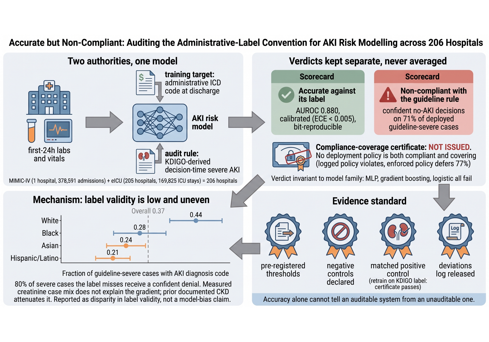

# Accurate but Non-Compliant

<p align="center">
  
</p>

<p align="center"><sub>A model accurate against its administrative label (AUROC 0.880) issues confident no-AKI decisions on 71% of guideline-severe cases; the compliance-coverage certificate is not issued for any deployment policy.</sub></p>
Code, pre-registration and aggregate results for **"Accurate but Non-Compliant:
Auditing the Administrative-Label Convention for AKI Risk Modelling across 206
Hospitals"** (anonymised review package, ML4H 2026 Proceedings track).

The paper audits a common convention: training and evaluating a clinical risk
model against an administrative diagnosis code, then reading its output as a
decision aid about the guideline-defined condition that code stands in for. The
audit harness tests a model paired with an explicit, version-controlled rule set
along three per-decision axes, each with a pass criterion frozen before test-fold
evaluation:

- **T1 — Replayability:** re-execution yields identical predictions and a matching version hash.
- **T2 — Constraint compliance:** per-decision evaluation against a guideline-derived hard rule, with a **compliance–coverage certificate** so a policy cannot pass by deferring the high-risk subgroup.
- **T3 — Calibrated abstention:** ECE against a pre-declared bound, coupled to an abstention threshold.

The contribution is not a new model or estimator; it is the pre-registered,
negative-control-validated measurement and the finding it produces. The protocol
was developed with neuro-symbolic systems as the motivating case (paper
Appendix L), which is why the harness package is still named `auditnesy_mimic`;
nothing in it requires a neuro-symbolic architecture.

## Headline finding
On acute kidney injury across **two EHR databases** — MIMIC-IV (378,591 admissions,
1 hospital) and eICU (169,825 ICU stays, **205 hospitals**) — a model that is accurate
against its administrative label (AUROC 0.88 / 0.85) issues **confident *no-AKI*
decisions on the majority of guideline (KDIGO)-severe cases it deploys on** (71% on
MIMIC-IV, 93% on eICU), because the administrative label under-codes AKI: only 37% of
KDIGO-severe MIMIC-IV cases carry an AKI code (44% White vs 28% Black patients). No
deployment policy is both compliant and adequately covering, the failure is invariant
to model family while accuracy is not, and a matched positive control that changes
only the training target makes it disappear.

## Repository layout
```
.
├── preregistration.md          # frozen pass criteria (prereg-v1.0 … v1.3) and deviations log
├── preregistration_v14.md      # continuation log: every later deviation, v1.4 … v1.9
├── LICENSE                     # MIT, code and aggregate results only
│
├── mimic_pipeline/             # the audit harness (dataset-agnostic) + MIMIC-IV arm
│   ├── auditnesy_mimic/        #   config, cohort, metrics, models, audit (T1/T2/T3 + probe
│   │                           #   + compliance–coverage certificate), negative_controls, experiment
│   ├── scripts/                #   00–02 build and run the audit; 03–11 are the analyses
│   │                           #   (see "Analysis scripts" below)
│   │                           #   + ADJUDICATION_INSTRUCTIONS.md — the sheet adjudicators
│   │                             receive; part of the protocol, so it sits beside its script
│   ├── tests/                  #   unit, non-vacuity and repository-hygiene tests (no data needed)
│   ├── results/                #   aggregate result JSONs (DUA-safe, no patient rows)
│   └── FINDINGS.md, README.md, config.yaml, requirements.txt, Makefile
│
├── eicu_pipeline/              # eICU multi-center replication (reuses the harness)
│   ├── build_eicu_cohort.py    #   eICU cohort adapter (only dataset-specific piece)
│   ├── run_eicu.py             #   runs the harness on eICU with a held-out-hospital shift
│   ├── 00_check_eicu_labnames.py, dump_eicu_figdata.py
│   ├── results/                #   aggregate eICU JSONs (DUA-safe)
│   └── EICU_PLAN.md, EICU_FINDINGS.md
│
├── pima_pipeline/              # portability check on a public dataset (no DUA needed)
│   ├── scripts/                #   10_pima_audit, 11_pima_styles, 12_pima_probe
│   ├── data/PROVENANCE.md      #   where the CSV came from, checksums, and its caveats
│   │                           #   (the CSV itself is gitignored; PROVENANCE says how to fetch it)
│   ├── tests/                  #   T1 non-vacuity + results self-consistency guards
│   └── results/, README.md
│
├── figures/                    # standalone figure generation (seaborn + matplotlib)
│   ├── make_fig_overview.py    #   Figure 1: every number parsed from a source file
│   │                           #   (expects the paper source at the root; absent here, so the
│   │                           #   two tests that read it skip rather than pass)
│   ├── make_figures.py, make_eicu_figures.py, dump_figure_data.py
└── paper_figs/                 # the figures embedded in the paper
```

The paper source, earlier drafts and working notes are not part of this package:
they carry author-identifying material and are not needed to reproduce any result.

## Analysis scripts

`00`–`02` build the cohort and run the audit. `03`–`11` are the ten analysis
scripts referenced from the paper (counting `05b`); each is standalone, reads only
committed aggregate results or a cohort cache, and never mutates the harness.

| Script | What it answers | Output |
|---|---|---|
| `00_check_itemids.py` | Do the lab itemids resolve in this MIMIC copy? | stdout |
| `01_build_cohort.py` | Build and cache the cohort (gitignored) | `$AUDITNESY_OUT/aki_cohort.parquet` |
| `02_run_experiment.py` | 20-seed audit, negative controls, certificate | `audit_summary_*.json`, `per_seed_results.json` |
| `03_threshold_sensitivity.py` | Does the verdict survive moving the policy thresholds? | `threshold_sensitivity_v1.3.json` |
| `04_urine_output_arm.py` | How much does omitting the oliguric limb undercount? | `urine_output_arm.json` |
| `05_subgroup_audit.py` | Do compliance failures fall unevenly across patient groups? | `subgroup_audit.json` |
| `05b_label_validity_by_subgroup.py` | Label validity by group on the full cohort (no model needed) | `label_validity_by_subgroup.json`, `subgroup_significance.json` |
| `06_baselines.py` | Does the failure track model family, or only accuracy? | `model_arms_v14.json` |
| `07_severity_sensitivity.py` | Is the finding an artefact of the severity definition? | `severity_sensitivity_v14.json` |
| `08_stratified_label_validity.py` | Is the subgroup gradient case-mix? (stratified + standardised) | `stratified_label_validity.json` |
| `09_matched_positive_control.py` | Same cohort, same features, only the target changes | `matched_positive_control.json` |
| `10_prior_ckd_sensitivity.py` | Does the gradient survive adjusting for prior renal disease? | `prior_ckd_sensitivity.json` |
| `11_clinician_adjudication.py` | Is the audit constraint a defensible reading of KDIGO? | packet (gitignored) → `clinician_adjudication.json` |

`11` is the one analysis that is **not** complete: it draws a blinded 200-case
packet and scores returned adjudications, with the falsification thresholds fixed
in source before any adjudication exists. What it lacks is clinicians. The packet
and its unblinding key are patient-level and gitignored; both regenerate from the
seed and stratum targets recorded in the script.

`scripts/ADJUDICATION_INSTRUCTIONS.md` is the sheet the adjudicators receive. It is
released because it is **part of the protocol**, not correspondence: it fixes what a
reviewer is and is not shown, states that a blank answer means "cannot tell" rather
than "no", and tells them in advance that either outcome will be reported. Anyone
replicating the adjudication needs it to replicate the measurement.

Recruitment correspondence is a different thing and is **not** in this repository —
email drafts carry author names, institution and deadlines, so they would break
double-blind review and publish material no reader needs.

## Reproducing the results
Requires credentialed PhysioNet access to MIMIC-IV and eICU (separate DUAs). **No patient-level
data are included in this repository** (see below).

```bash
# MIMIC-IV
cd mimic_pipeline && pip install -r requirements.txt
export MIMIC_DIR=/path/to/mimiciv/hosp AUDITNESY_OUT=./audit_mimic_out
python scripts/00_check_itemids.py       # verify lab itemids
python scripts/01_build_cohort.py        # build + cache cohort (gitignored)
python scripts/02_run_experiment.py      # 20-seed audit + negative controls + certificate

# Analysis scripts 03–11 (each standalone; see the table above)
python scripts/03_threshold_sensitivity.py
python scripts/04_urine_output_arm.py         # uses AUDITNESY_OUT; needs the MIMIC-IV icu module
python scripts/05_subgroup_audit.py --cohort audit_mimic_out/aki_cohort.parquet
python scripts/05b_label_validity_by_subgroup.py --cohort audit_mimic_out/aki_cohort.parquet
python scripts/06_baselines.py --cohort audit_mimic_out/aki_cohort.parquet
python scripts/07_severity_sensitivity.py --cohort audit_mimic_out/aki_cohort.parquet
python scripts/08_stratified_label_validity.py --cohort audit_mimic_out/aki_cohort.parquet
python scripts/09_matched_positive_control.py \
    --icd-cohort audit_mimic_out/aki_cohort.parquet \
    --kdigo-cohort audit_mimic_kdigo/aki_cohort.parquet   # needs a second cohort build
python scripts/10_prior_ckd_sensitivity.py --cohort audit_mimic_out/aki_cohort.parquet
python scripts/11_clinician_adjudication.py sample --n 200   # draws the review packet

# Pima portability check (public data, no DUA — see pima_pipeline/data/PROVENANCE.md)
cd ../pima_pipeline
python scripts/10_pima_audit.py && python scripts/11_pima_styles.py && python scripts/12_pima_probe.py
cd ../mimic_pipeline

# eICU (multi-center replication)
cd ../eicu_pipeline
export EICU_DIR=/path/to/eicu-crd EICU_OUT=./eicu_out
python 00_check_eicu_labnames.py
python build_eicu_cohort.py
python run_eicu.py

# Figures (from the committed aggregate results)
cd ../figures && pip install -r requirements.txt
python make_figures.py && python make_eicu_figures.py

# Tests (no data needed)
cd ../mimic_pipeline && python -m pytest tests/ -q   # 50 tests (15 skip without the cohort cache)
cd ../pima_pipeline  && python -m pytest tests/ -q   # 10 tests (3 skip without the CSV)
```

Data-dependent tests **skip** rather than pass when the cohort cache is absent, so a
green run without MIMIC access does not mean the data-facing logic was exercised.

## Pre-registration
All pass thresholds were frozen **before** any test-fold evaluation and version-controlled as
git tags `prereg-v1.0 … prereg-v1.3`. Those tags and their commit history live in the
authors' identifying repository and cannot be included in an anonymised package; this
package carries the dated pre-registration and deviations files, and the tagged history
will be made public with the camera-ready version. Every constraint correction is logged as a deviation in
`preregistration.md`, continued in `preregistration_v14.md` for revisions v1.4–v1.9;
**no pass threshold was ever changed after seeing results** — only the clinical/logical
scope of the T2 constraint. Each mis-specification was itself flagged by the audit's own T2 axis.

The deviations log also records what went the other way: two registered negative controls
that never fired, a positive control whose effect is largely target arithmetic, an analysis
whose interpretation was rewritten after its first output contradicted our reading, and a
subgroup claim we narrowed ourselves after adjusting for prior renal disease. Deviations are
numbered and each names its consequence.

## Claims are tested, and the tests are mutation-checked
Beyond unit tests, the suite guards the things that could silently drift:

- **Non-vacuity** — a test that cannot fail is worse than no test. Every guard was verified by
  mutation: reintroduce the defect, watch the named test fail, restore, confirm byte-identical.
- **Results self-consistency** — no verdict word in a results file may contradict the numbers
  beside it. Two real defects of this shape were caught this way and are recorded in
  `pima_pipeline/README.md` rather than quietly fixed.
- **Repository hygiene** — `tests/test_no_patient_data_committed.py` fails if a patient-level
  file becomes committable, if tracked JSON carries populated identifiers, or if a data file
  ever appears in git history.
- **Figure provenance** — `tests/test_fig_overview_numbers.py` fails if any number in Figure 1
  becomes a literal in the plotting script instead of being parsed from its source file. This
  guard exists because the script once *claimed* full provenance while hardcoding two values;
  the false claim was the defect, not the values, which happened to be right.

## Data availability & ethics
MIMIC-IV and eICU are available via **PhysioNet under credentialed access and signed Data Use
Agreements**. Per the DUAs, **no patient-level data or derived patient-level artifacts** are
redistributed here. That includes cohort caches and output directories, decision-trace bundles,
and the clinician-adjudication packet and its unblinding key — all gitignored, and the last two
regenerable from parameters recorded in `11_clinician_adjudication.py`. Committed result files
are **aggregate only** (no patient rows), which
`mimic_pipeline/tests/test_no_patient_data_committed.py` enforces rather than asserts. The
example decision trace in the paper is **synthetic** and labelled as such.

Both source databases were approved by the review boards of the institutions that collected
them (MIMIC-IV by the IRBs of Beth Israel Deaconess Medical Center and MIT, with waiver of
informed consent; eICU under a similar approved arrangement) and are distributed
de-identified to credentialed investigators. This work is a secondary analysis of those
de-identified databases; the authors' institution determined that it does not constitute
human-subjects research. Anyone reproducing this work should seek their own institutional
determination.

The Pima dataset (`pima_pipeline/`) is public and carries no DUA, but the CSV is still
gitignored — the dataset was withdrawn from its original repository, so
`pima_pipeline/data/PROVENANCE.md` records the mirrors, byte-level cross-check and checksums
instead of a URL that no longer resolves to the data actually used.

## License
MIT (see `LICENSE`), covering the code, configuration, pre-registration and aggregate results
in this repository. It does not and cannot cover MIMIC-IV or eICU, which remain under
PhysioNet's Data Use Agreements.
